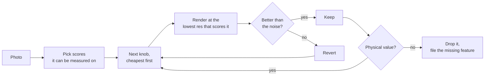
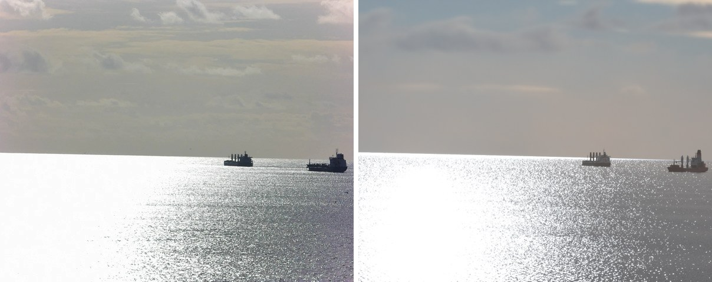

# Matching a photo

Recreating a real frame is an optimisation: pick scores that measure how far the render is from the photo, then fit the scenario's knobs to minimise them, cheapest first. Fit only the knobs, never the physics.

| Stage | Tip |
|---|---|
| **Geometry** | Use AIS or other sensors when you have them; otherwise fit. |
| | Roll comes straight from the photo's horizon tilt. |
| | Fit on target-only silhouettes at half res: hundreds of renders are cheap. |
| **Sky** | Rank HDRIs by their pixels against the photo's sky, without rendering. |
| | Glint under cloud needs `sky.sun_diffuse_fraction`. Use it only in a manual scene. |
| **Camera** | Fit exposure together with the sun: the meter reads the whole frame. |
| **Scoring** | Re-render with other seeds first: smaller gains are noise. |
| | A knob that disagrees between scores may be absorbing an asset mismatch. |
| | A value outside physics means a missing feature: file it, don't keep it. |

[`matching-a-photo.toml`](matching-a-photo.toml) is one such fit: a cliff camera, two merchant ships and a hidden sun under broken cloud. The photo is on the left, the render on the right.

