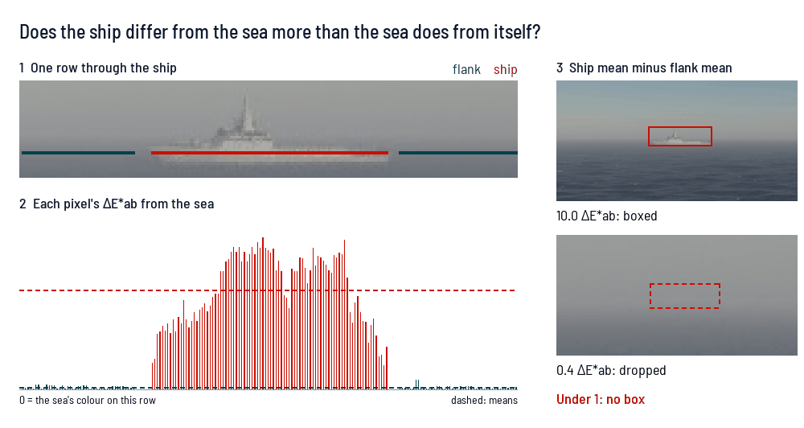

# Outputs

`labels.json` is the ground truth, in [COCO's detection format](https://cocodataset.org/#format-data): per frame, a box around each target with its range and bearing from the camera, its true heading, its `dims_m` (length, beam and height above the waterline, as built), the horizon, and what rendered it. A box's category is its asset's type, under its kind's supercategory (vessel, buoy, debris, structure), with a fixed id, so every `labels.json` agrees. FiftyOne reads the boxes and their fields as they are; the per-frame keys (`horizon_px`, `camera`, `band`, `hfov_deg`, `time_s`) stay in the JSON:

```python
import fiftyone as fo

fo.Dataset.from_dir("out/", fo.types.COCODetectionDataset, data_path=".")
```

A target a viewer cannot tell from its surroundings gets no box, as an occluded one gets none. On each of its rows the background is the line through the medians of the background either side, past the few pixels its own glare reaches. The target's mean ΔE*ab from that line, less the flanks' mean ΔE*ab from it, is its excess, a local target-to-clutter contrast (Schmieder & Weathersby 1983). Under `labels.MIN_EXCESS_DE` the target is dropped. Only an 8-bit frame as written is judged, EO or LWIR: an exr or a 16-bit LWIR png keeps every box.

With `outputs.keep_if_any_sees`, a target that any camera of a band sees at an instant is boxed in every camera of that band that has it in frame.

Every target left without a box is listed under `dropped`, with its image, range, bearing and reason: `no_pixels` (out of frame or hidden), or `low_contrast`, with its excess, box and area.



`render --variants` writes one `labels.json` per seed folder and merges them into one beside the folders: ids renumbered, each `file_name` from there, and each seed's scenario, every drawn value in it, under `info.scenarios` by its folder.

An LWIR jpg is what a thermal camera shows: 8-bit grey through the camera's `agc`, its curve damped so a clip does not flicker. An LWIR png is what it measures: 16-bit centikelvin, the unit radiometric thermal cameras write, so `cv2.imread(path, cv2.IMREAD_UNCHANGED) / 100` is kelvin. A viewer shows that as flat grey; `montage`, `panorama` and `video` tone it through the same AGC as the jpg.

The AGC defaults to a FLIR Boson+'s factory settings, information-based equalisation: detail takes the greys a smooth sea or sky would. `agc = { preset = "night" }` takes one of FLIR's presets for its Boson-based M364C LR (`day`, `night`, `high_contrast`, `dock`); a field beside it, set or drawn, overrides the preset. `information_based = false` is plain plateau equalisation, and `linear_fraction = 1` a linear stretch, which leaves a frame with a hot exhaust a few greys. Seeds that drew different AGCs are toned one seed folder at a time: `panorama` and `video` refuse their merged set.

`seascape montage` lays a render out for review, one row per band, each frame captioned with its camera. It reads the images already written, so it needs no Blender and a layout can be redone without re-rendering:

```bash
uv run seascape render scenarios/twin-pod.toml -o out/
uv run seascape montage scenarios/twin-pod.toml -o out/   # out/montage.png
```

`seascape panorama` stitches each rig's frames, per band, from `calibration.json`:

```bash
uv run seascape panorama out/ --projection rectilinear --frame rig --ruler
```
